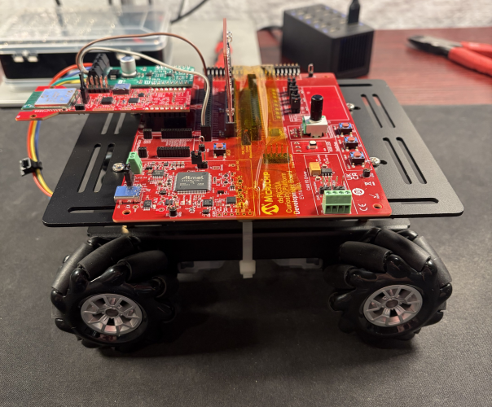
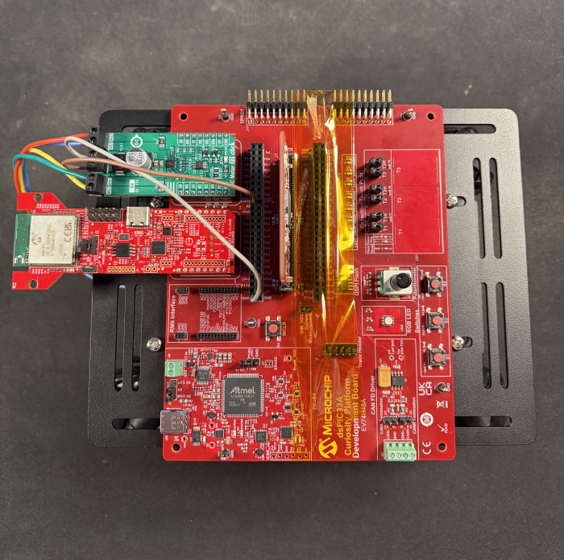
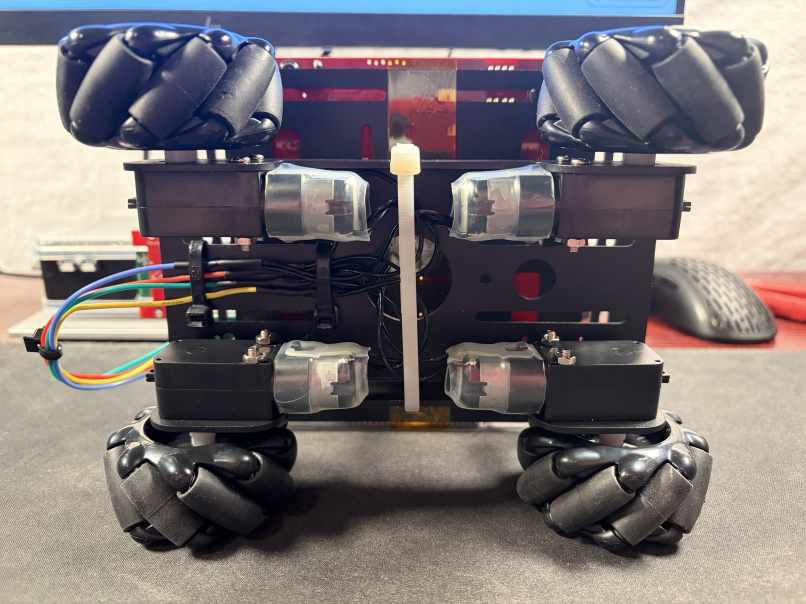
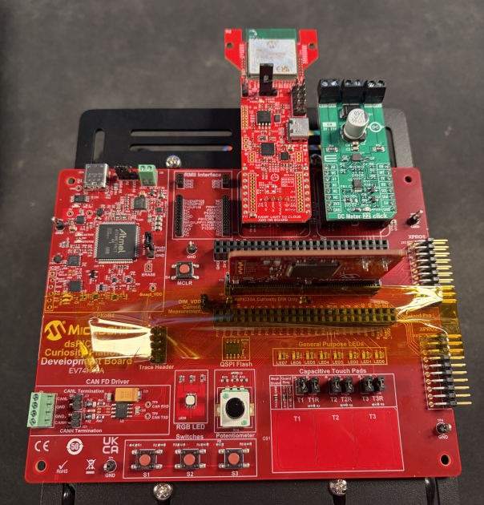
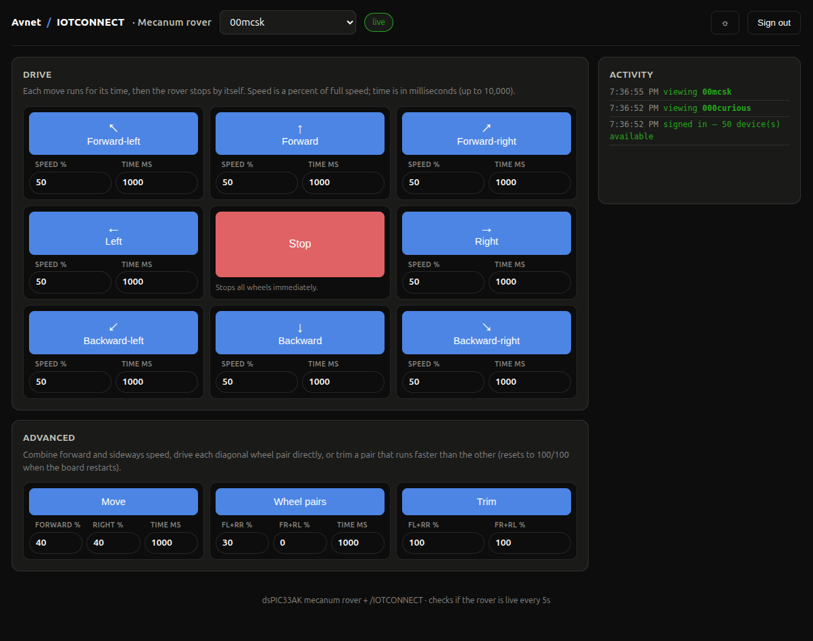

# dsPIC33AK512MPS512 Mecanum Rover + RNWF11 /IOTCONNECT Expansion Demo

An expansion of the [dsPIC33AK512MPS512 + RNWF11 /IOTCONNECT Quickstart](../README.md)
that drives a four-wheel mecanum rover from [Avnet /IOTCONNECT](https://www.iotconnect.io/).
It uses the same board, RNWF11 and provisioning scripts as the basic quickstart, with its own
firmware, device template and web dashboard.
The Microchip **dsPIC33AK512MPS512** (on the **dsPIC33 Curiosity Platform Development Board**)
connects to /IOTCONNECT using /IOTCONNECT's [C SDK](https://github.com/avnet-iotconnect/iotc-c-lib),
over the Microchip **RNWF11 UART to Cloud Add-on Board**,
and drives the rover's four motors through a Mikroe **DC Motor 22 Click**.
No RTOS, no MQTT/TLS stack on the MCU.
The RNWF11 owns the WiFi/MQTT/TLS connection itself, using a certificate and key stored on its own
filesystem, and the dsPIC33 just talks to it over UART with AT commands.

The rover drives forward and backward, strafes sideways and moves diagonally,
from movement commands sent by a web dashboard (or the /IOTCONNECT console).
Every move runs for a set time and then stops.
It publishes its status (motor driver health, last command, uptime) to /IOTCONNECT every 10 seconds.



## Table of Contents

1. [Prerequisites](#1-prerequisites)
2. [Get the Quickstart Source](#2-get-the-quickstart-source)
3. [Cloud Account Setup](#3-cloud-account-setup)
4. [Import the Device Template](#4-import-the-device-template)
5. [Generate and Upload the Device Certificate](#5-generate-and-upload-the-device-certificate)
6. [Create the Device in /IOTCONNECT](#6-create-the-device-in-iotconnect)
7. [Assembling the Rover](#7-assembling-the-rover)
8. [Flash and Configure the Firmware](#8-flash-and-configure-the-firmware)
9. [Run the Demo](#9-run-the-demo)
10. [Resources](#10-resources)

## 1. Prerequisites

### Hardware

1. [dsPIC33 Curiosity Platform Development Board (EV74H48A)](https://www.microchip.com/en-us/development-tool/ev74h48a)
2. [dsPIC33AK512MPS512 General Purpose DIM (EV80L65A)](https://www.microchip.com/en-us/development-tool/ev80l65a),
   installed in the Curiosity board

   

3. [RNWF11 UART to Cloud Add-on Board (EV12H55A)](https://www.microchip.com/en-us/development-tool/ev12h55a)
4. [Mikroe DC Motor 22 Click](https://www.mikroe.com/dc-motor-22-click)
5. [LewanSoul Mecanum Wheel Chassis Car Kit](https://www.amazon.com/dp/B093WDD9N5)
6. 1 USB-C cable
7. A 2.4 GHz WiFi network

### Tools and Materials

1. Soldering iron and solder
2. Heat-shrink tubing or electrical tape
3. Phillips screwdriver
4. Small flathead screwdriver
5. Zip ties
6. Small pliers
7. 22 AWG electronics wire, stranded and solid-core

### Untethered Power (Optional)

While you set up and test, the Curiosity board runs from your PC's USB port.
To drive the rover around, power it from one of these instead:

- A portable USB power bank, e.g. the [56800mAh Portable Charger](https://www.amazon.com/dp/B0GQZKGGQH), or
- A stationary 5V USB power supply with at least **2.4A** output, plus a long USB-C cable

> [!IMPORTANT]
> A PC's USB port typically only supplies 0.5-0.9A.
> That's enough for bench testing with the wheels in the air,
> but four motors pushing the rover across the floor can pull the board's supply down
> far enough that it resets. When that happens, the rover is offline for about 20-30 seconds
> while it reconnects, and any commands sent in that time are lost.
> The `up` telemetry field (seconds since the board started) dropping back to 0 shows a reset.

### Software

1. [MPLAB IPE](https://www.microchip.com/mplab/mplab-integrated-programming-environment)
   (for flashing the prebuilt `.hex`)
2. `openssl` on your `PATH` (already present on most Linux systems.
   On Windows it's included with [Git for Windows](https://git-scm.com/downloads/win), among other sources.)
3. Either Python 3.9+ **or** PowerShell 5.1+ (Windows ships this by default. PowerShell 7+ also works on Linux.)
   to run the provisioning scripts. Pick whichever you're more comfortable with, both do the same thing
4. A serial terminal (PuTTY, Tera Term, MPLAB Data Visualizer's terminal, etc.) to watch the device's console output

> [!NOTE]
> Want to modify the firmware itself instead of just running the demo? See
> [DEVELOPER.md](DEVELOPER.md). Building from source needs MPLAB X IDE, the
> XC-DSC compiler, and the `dsPIC33AK-MP_DFP` device pack instead of IPE.

## 2. Get the Quickstart Source

Download each of the files below by opening its link, then clicking the
**Download raw file** button at the top right of the file viewing window.
Put them all in one new, empty folder on your PC. That's your working
directory for the rest of this guide.

1. Prebuilt firmware:
   [`dspic33ak-rover-rnwf11-iotconnect-demo.hex`](bin/dspic33ak-rover-rnwf11-iotconnect-demo.hex)
2. Device template:
   [templates/dspic33-rover-template.json](templates/dspic33-rover-template.json)
3. Provisioning scripts for your host OS:
   - **Linux/macOS (Python)**:
     [tools/provision_rnwf11_cert.py](../tools/provision_rnwf11_cert.py),
     [tools/provision_device_config.py](../tools/provision_device_config.py),
     [tools/requirements.txt](../tools/requirements.txt)
   - **Windows (PowerShell)**:
     [tools/provision_rnwf11_cert.ps1](../tools/provision_rnwf11_cert.ps1),
     [tools/provision_device_config.ps1](../tools/provision_device_config.ps1)

## 3. Cloud Account Setup

An /IOTCONNECT account with an **AWS backend** is required. If you need to create an account, a
**free trial subscription** is available — no credit card required:

- Sign
  up: [https://subscription.iotconnect.io/subscribe?cloud=aws](https://subscription.iotconnect.io/subscribe?cloud=aws)
  (see
  the [AWS Marketplace option](https://github.com/avnet-iotconnect/avnet-iotconnect.github.io/blob/main/documentation/iotconnect/subscription/iotconnect_aws_marketplace.md)
  if you prefer)
- Log in: [https://console.iotconnect.io/login](https://console.iotconnect.io/login)

> [!NOTE]
> Be sure to check your SPAM folder for the temporary password after registering if you don't see
> it after a couple of minutes.

## 4. Import the Device Template

The template defines the rover's telemetry and its movement commands.
Import [`templates/dspic33-rover-template.json`](templates/dspic33-rover-template.json).

1. Log in at [console.iotconnect.io](https://console.iotconnect.io).
2. Open the **Device** module:

   

3. At the bottom of the page, click **Templates**:

   

4. Click **Create Template**:

   

5. Click **Import**, and select
   [`templates/dspic33-rover-template.json`](templates/dspic33-rover-template.json)
   you downloaded in Step 2:

   

## 5. Generate and Upload the Device Certificate

The RNWF11 board has its own USB-C port and power-select jumper
(`PC3V3` / `HOST3V3`), independent of the Curiosity board. This step uses it
standalone, **not** mounted on the Curiosity board yet.

Move the jumper to **PC3V3** and plug the RNWF11's USB-C port directly into
your PC.

<table>
  <tr>
    <td align="center">
      <br><b>PC3V3</b>, flashing/provisioning (this step)
    </td>
    <td align="center">
      <br><b>HOST3V3</b>, normal operation (Step 7)
    </td>
  </tr>
</table>

**Before running the command below**, find the serial port name it just
enumerated as, **the full path/name, not just the last part** (e.g.
`/dev/ttyACM0`, not `ttyACM0`):
- **Linux**: run `ls /dev/serial/by-id/` (or `dmesg | tail` right after
  plugging it in). Look for the RNWF11's MCP2200 USB-to-UART bridge, e.g.
  `/dev/ttyACM0`.
- **macOS**: run `ls /dev/cu.*`. Look for something like `/dev/cu.usbmodemXXXX`.
- **Windows**: open Device Manager &rarr; **Ports (COM & LPT)**. Look for
  "MCP2200 USB Serial Port Emulator" and note its `COMx` number (e.g. `COM6`).

The firmware expects the default filenames on the RNWF11's own filesystem
(`root-ca` / `device-cert` / `device-key`), so the `--ca-name`/`--cert-name`/
`--key-name` flags can stay at their defaults.

From the folder you downloaded the files into in Step 2:

**Linux/macOS:**
```bash
pip3 install -r requirements.txt
curl -fsSLO https://www.amazontrust.com/repository/AmazonRootCA1.pem
```

Replace `MYPORTNAME` with the port you found above, and `MYUNIQUEID` with a
Unique ID of your own choosing for this device, pick something memorable,
e.g. `my-rover`. You'll reuse whatever you pick later, both when
creating the device in /IOTCONNECT and when configuring the firmware.
```bash
python3 provision_rnwf11_cert.py --port MYPORTNAME --duid MYUNIQUEID --ca-cert-path AmazonRootCA1.pem
```

**Windows (PowerShell):**
```powershell
Invoke-WebRequest https://www.amazontrust.com/repository/AmazonRootCA1.pem -OutFile AmazonRootCA1.pem
```

Replace `MYPORTNAME` with the port you found above, and `MYUNIQUEID` with a
Unique ID of your own choosing for this device, pick something memorable,
e.g. `my-rover`. You'll reuse whatever you pick later, both when
creating the device in /IOTCONNECT and when configuring the firmware.
```powershell
.\provision_rnwf11_cert.ps1 -Port MYPORTNAME -Duid MYUNIQUEID -CaCertPath AmazonRootCA1.pem
```

> [!TIP]
> Keep the Unique ID to about 20 characters or less.
> It's part of the MQTT topics the rover publishes on, and the RNWF11 limits how long a
> publish can be, so a long ID leaves no room for the message that comes back
> when a command is rejected.

This generates a self-signed device certificate, prints it to the terminal,
and uploads the CA cert, device cert, and device key to the RNWF11's own
filesystem via `AT+FS`. You'll paste the printed device certificate into the
/IOTCONNECT console in the next step.

> [!NOTE]
> This can take up to 60 seconds to finish depending on your host PC environment.

## 6. Create the Device in /IOTCONNECT

1. After logging into your /IOTCONNECT account on
   [console.iotconnect.io](https://console.iotconnect.io), go to the
   **Device** page and click **Create Device**:

   

2. Set the Unique ID and Device Name:

   

   - **Unique ID**: must be the **exact same** `MYUNIQUEID` value you passed
     to `provision_rnwf11_cert.py`/`.ps1` earlier. This is the DUID, and
     it's what ties everything together.
   - **Device Name**: a separate display name shown in the
     /IOTCONNECT console with looser character constraints (e.g. can use spaces)

3. Select your **Entity**:

   

4. Select the template you imported earlier in
   [Step 4](#4-import-the-device-template):

   

5. Under **Device certificate**, choose **Use my certificate**, and paste
   the certificate PEM that `provision_rnwf11_cert.py`/`.ps1` printed:

   

6. Click **Save & View**.

## 7. Assembling the Rover

You will need a phillips-head screwdriver and a small pair of pliers
(for holding nuts while tightening some screws) for the assembly.

Follow
[this assembly guide video](https://www.amazon.com/live/video/0834f4dc06c44533a88f57900d84450c?ref_=cm_sw_cp_r_ib_dt_UfI0sVFk76dT1)
for the rover.

<table>
  <tr>
    <td align="center"><br>Top-down view</td>
    <td align="center"><br>Underside view</td>
  </tr>
</table>

### Motor Wiring

The DC Motor 22 Click has two motor channels, so each channel drives one **diagonal pair** of
motors wired in parallel. That's enough for forward, backward, sideways (strafe) and diagonal
moves. It can't rotate the rover in place, which would need the two wheels of a diagonal pair to
turn opposite ways.

Pick one end of the rover as the front, then name the motors front-left (FL), front-right (FR),
rear-left (RL) and rear-right (RR). Each diagonal pair goes to one channel of the click:

```
            FRONT
   FL (A)            (B) FR
        \           /
          \       /          A = front-left + rear-right  -> click terminals MA1 / MA2
            \   /            B = front-right + rear-left  -> click terminals MB1 / MB2
              X
            /   \
          /       \
        /           \
   RL (B)            (A) RR
            REAR
```

Each pair is joined at two **solder joints**. Each joint ties together one lead from each of the
pair's two motors, plus one 22 AWG stranded extension wire that runs up to the click.

#### Motor Lead Polarity

Both leads on every motor are black and end in a small 2-pin connector, so the only way to tell
them apart is by their position in that connector. Hold each motor's connector the same way
(for example, latch facing up and the wires coming toward you) and call the lead on the left
**lead 1** and the lead on the right **lead 2**. Then either:

- mark each lead with a piece of tape (e.g. "FL 1", "FL 2") before cutting the connector off, or
- cut the leads out of the connector one at a time as you solder them, so you always know which is which.

The left and right motors face opposite directions, so the leads are **crossed** at each joint.
The left-side motor's lead 1 joins the right-side motor's lead 2, and vice versa.
Every joint must have one lead of each polarity, never two lead 1s or two lead 2s.

| Joint | Motor leads soldered together | Extension wire goes to |
|---|---|---|
| 1 | front-left **lead 1** + rear-right **lead 2** | **MA1** |
| 2 | front-left **lead 2** + rear-right **lead 1** | **MA2** |
| 3 | rear-left **lead 1** + front-right **lead 2** | **MB1** |
| 4 | rear-left **lead 2** + front-right **lead 1** | **MB2** |

```
  Motor leads (underside)        solder joint                    DC Motor 22 Click

  front-left  lead 1 ───────────┐
  rear-right  lead 2 ───────────●──── stranded extension wire ───> MA1
  front-left  lead 2 ───────────┐
  rear-right  lead 1 ───────────●──── stranded extension wire ───> MA2
  rear-left   lead 1 ───────────┐
  front-right lead 2 ───────────●──── stranded extension wire ───> MB1
  rear-left   lead 2 ───────────┐
  front-right lead 1 ───────────●──── stranded extension wire ───> MB2
```

#### Soldering

For each joint:

1. Cut an extension wire long enough to reach from the joint, up past the edge of the top plate,
   to the click's terminal block, with a few centimeters of slack.
   Using a different wire color for each joint makes them easy to tell apart later.
2. Strip about 1 cm from the two motor leads and the extension wire, twist them together, and solder.
3. **Insulate every joint**: slide heat-shrink tubing over it from the extension wire's free end and
   shrink it, or wrap it tightly with electrically insulating tape.
   A bare joint touching the aluminum chassis or another joint will short the motor outputs.

> [!TIP]
> If a joint ends up with the wrong polarity, that motor runs against its diagonal partner.
> The direction test in [Step 9](#wheel-direction-test) catches it.

### Curiosity Board Mounting

Secure the Curiosity board to the top plate with zip ties through the chassis slots, or with
electrically insulating tape (such as polyimide/Kapton tape) across the board as shown in the
top-down view. Leave the board's USB-C port reachable.

> [!IMPORTANT]
> The chassis is aluminum, which conducts electricity, and the pins and solder joints on the
> underside of the Curiosity board must not touch it or the screw heads sticking up from the top
> plate. Place the board **between the screw heads**, not on top of them, so a screw head can't
> short pins on the bottom of the board. Alternatively, either:
> - cut a sheet of insulating material, such as cardboard, to fit between the chassis and the board
>
>     or
>
> - cover the screw heads with electrically insulating tape.

### Click Board Placement

Unplug the USB-C cable from the RNWF11 (you'll use it for the Curiosity board in Step 8),
move the RNWF11's power jumper back to **HOST3V3**, then mount the two click boards on the Curiosity board:

| Board | mikroBUS socket |
|---|---|
| RNWF11 UART to Cloud Add-on Board | **A** |
| DC Motor 22 Click | **B** |



> [!IMPORTANT]
> The sockets are not interchangeable. The firmware routes the RNWF11's UART to mikroBUS A
> and the DC Motor 22 Click's UART to mikroBUS B.

### Motor Connections

The click has three 2-pin terminal blocks, **MA1/MA2** (channel A), **VS/GND** (motor power) and
**MB1/MB2** (channel B). Connect the four extension wires as in the table above, tighten each
terminal screw with the small flathead screwdriver, and give each wire a gentle tug.
Make sure no stray strands touch a neighboring terminal.

Which wire of a pair goes to "1" and which to "2" only sets that pair's overall direction.
You'll check it with the wheels off the ground in [Step 9](#wheel-direction-test),
and fix it by swapping the pair's two wires if needed.

### Motor Power

The click only takes motor power from its **VS/GND** terminal block, not from the mikroBUS socket.
Run two solid-core 22 AWG wires from the Curiosity board's long female headers (**J3** or **J10**)
to the click:

```
  Curiosity board header (J3 or J10)                DC Motor 22 Click

  pin labeled 5V   ──────── solid-core wire ─────────> VS
  pin labeled GND  ──────── solid-core wire ─────────> GND
```

Strip about 5 mm from each end. The solid-core ends push straight into the header sockets.
The GND wire gives the motor current its own return path instead of the small mikroBUS ground pins,
which keeps motor noise away from the board's logic.

### Cable Management

Use zip ties to bundle the motor leads, solder joints and extension wires against the chassis,
as shown in the underside view, and route them well clear of the wheels and their rollers.
A wire caught in a mecanum wheel's rollers can stall the motor or pull a joint apart.

## 8. Flash and Configure the Firmware

Connect the Curiosity board's USB-C port to your PC. The click boards stay mounted from Step 7.

You already have the ready-to-flash
[`bin/dspic33ak-rover-rnwf11-iotconnect-demo.hex`](bin/dspic33ak-rover-rnwf11-iotconnect-demo.hex)
from Step 2. No compiler, no opening the firmware project.

1. Open **MPLAB IPE**. Under **Device**, select **dsPIC33AK512MPS512**
   (start typing `dsPIC33AK512...` and the dropdown narrows down to it).
   Under **Tool**, select the connected **PKOB4**.
2. Under **Browse**, select
   [`dspic33ak-rover-rnwf11-iotconnect-demo.hex`](bin/dspic33ak-rover-rnwf11-iotconnect-demo.hex)
   you downloaded in Step 2.
3. Click **Connect**, then **Program**.

   

4. Unplug and replug the board's USB-C cable so the new firmware starts.

> [!TIP]
> **Program** only becomes clickable if you selected the `.hex` file
> *before* clicking **Connect**. If you connected first and it's staying
> grayed out, click **Disconnect** then **Connect** again (no need to
> re-browse for the file) and it should become clickable.

The board's single USB-C cable shows up as **two separate serial ports**. One is for the PKOB4
programmer/debugger, and the other comes from an onboard MCP2221A USB-UART chip, which is the firmware's
console. Find the console port:
- **Linux**: run `ls /dev/serial/by-id/` and look for the entry with "MCP2221" in its name.
- **macOS**: run `ls /dev/cu.*` and look for something like `/dev/cu.usbmodemXXXX`.
- **Windows**: open Device Manager &rarr; **Ports (COM & LPT)** and look for
  "MCP2221 USB-UART Combo" (or similar), distinct from the PKOB4 port.

If you open a serial terminal on it at 115200 8-N-1, you'll see the firmware check the motor driver
and wait for its configuration:

```
=== dsPIC33AK512MPS512 + RNWF11 IoTConnect Mecanum Rover Demo ===
Motor driver found
Not provisioned yet.
```

If it prints `Motor driver not responding` instead, check that the DC Motor 22 Click is in
mikroBUS B and its VS terminal is powered (Step 7).
**Close the serial terminal before the next command**, since it needs the same port.

This binary ships unprovisioned. It has no WiFi or /IOTCONNECT credentials
built in, so it won't connect to anything yet on its own.
`provision_device_config.py`/`.ps1` resolves your device's /IOTCONNECT connection details
(broker, telemetry/command/acknowledgement topics) and pushes them, with your WiFi credentials,
over the serial connection into a dedicated flash page the firmware reads at boot:

**Linux/macOS:**
```bash
python3 provision_device_config.py --port MYPORTNAME --wifi-ssid "MYSSID" --wifi-password "MYPASSWORD" --cpid MYCPID --env MYENVIRONMENT --duid MYUNIQUEID --commands
```

**Windows (PowerShell):**
```powershell
.\provision_device_config.ps1 -Port MYPORTNAME -WifiSsid "MYSSID" -WifiPassword "MYPASSWORD" -Cpid MYCPID -Env MYENVIRONMENT -Duid MYUNIQUEID -Commands
```

Replace `MYPORTNAME` with the console port you found above,
`MYSSID`/`MYPASSWORD` with your real WiFi credentials (kept in quotes since either may contain spaces),
`MYCPID`/`MYENVIRONMENT` with the values under **Settings &rarr; Key Vault** in the /IOTCONNECT console,
and `MYUNIQUEID` with the same Unique ID you used in Steps 5 and 6.
`--commands`/`-Commands` also sends the topics the rover receives commands on and acknowledges them on.
The basic quickstart's firmware doesn't use them, so its guide leaves that option off.

The script prints the resolved broker and topics, then `OK` once the board has saved them.
The board then connects to WiFi and /IOTCONNECT on its own.

> [!NOTE]
> If the board is already provisioned and busy retrying a WiFi/MQTT connection, it only notices a
> new provisioning attempt in the gaps between connection attempts. The script retries every few
> seconds (up to 90 seconds), printing `No response yet...` while it does. That's normal.

> [!WARNING]
> Reflashing with MPLAB IPE (e.g. to update to a newer `.hex`) also erases the saved
> WiFi/IOTCONNECT config. Run `provision_device_config.py`/`.ps1` again afterward.

## 9. Run the Demo

Once provisioned, the rover connects to WiFi, then to /IOTCONNECT, subscribes to its commands,
and publishes its status every 10 seconds, which you can watch on the device's **Live Data** tab in the
/IOTCONNECT console:

```json
{"drv": 1, "ta": 100, "tb": 100, "cmd": "forward 50 1000", "up": 754}
```

| Field | Meaning |
|---|---|
| `drv` | Motor driver status (`0` not responding, `1` OK, `2` motor supply below 3.5V, `3` shut down on a short or overheat) |
| `ta` / `tb` | Speed trim (%) of the FL+RR / FR+RL wheel pairs, see [Calibration](#calibration) |
| `cmd` | The last command the rover accepted |
| `up` | Seconds since the board started. Dropping back to 0 means it reset |

### Web Dashboard



You can use this AWS-hosted dashboard to drive the rover. Open
[the dashboard](https://5r6g33fyjc.execute-api.us-east-1.amazonaws.com) and
sign in with your own /IOTCONNECT solution key, environment, email and password.

The dashboard has three panels:

- The **Drive** panel has a button for each direction (forward, backward, left, right and the four
  diagonals) with labeled **Speed %** and **Time ms** fields underneath each one, plus **Stop**.
  Each move runs for its time and then stops by itself.
- The **Advanced** panel exposes `move` (any mix of forward and sideways speed), `pairs` (each
  diagonal wheel pair's speed directly) and `trim`.
- The **Activity** log lists every command sent.

> [!NOTE]
> This dashboard is already deployed and hosted, so you don't need an AWS account to use it.
> To host your own copy, see [dashboard/README.md](dashboard/README.md).
> The same commands can also be sent from the device's **Commands** tab in the /IOTCONNECT console.
> See [DEVELOPER.md](DEVELOPER.md#2-rover-commands) for the full command reference.

### Wheel Direction Test

Lift the rover so its wheels spin freely, then send:

| Command | Expected |
|---|---|
| `pairs 30 0 2000` | front-left and rear-right spin **forward** for 2 seconds |
| `pairs 0 30 2000` | front-right and rear-left spin **forward** for 2 seconds |

- **Both wheels of a pair spin backward:** swap that pair's two wires on its terminal block
  (MA1/MA2 or MB1/MB2).
- **Only one wheel of a pair spins backward:** that motor's leads went to the wrong joints.
  Swap its two leads between the pair's two joints.

Then put the rover on the floor and try `forward 40`, `right 40` and `move 25 25` (diagonal).

> [!TIP]
> Mecanum wheels need grip. Run the demo on concrete, a rubber mat or low carpet.
> On a smooth table or glossy floor the rollers slip and strafing drifts.

### Calibration

Some rovers drift forward or backward while strafing because one wheel pair runs faster than the
other. On a good surface, send `left 50 2000` and `right 50 2000` and watch the drift:

- **Drifts forward going left and backward going right:** the front-right + rear-left pair is
  stronger. Lower the second trim value in steps of about 5, starting with `trim 100 90`.
- **Drifts backward going left and forward going right:** lower the first value instead,
  e.g. `trim 90 100`.

Repeat until the rover strafes straight. Trim resets to `100 100` whenever the board restarts,
so send it again after each power-up.

## 10. Resources

- [dsPIC33AK512MPS512 + RNWF11 /IOTCONNECT Quickstart](../README.md), the basic quickstart this demo expands on
- [DEVELOPER.md](DEVELOPER.md), covering building the firmware from source, the full command and telemetry
  reference, the hardware pin mapping, and what was learned bringing up the motor driver.
  Not needed just to run the demo.
- [dashboard/README.md](dashboard/README.md), the web dashboard's own documentation (architecture, deployment)
  for whoever maintains or hosts it. Not needed just to use it.
- [DC Motor 22 Click](https://www.mikroe.com/dc-motor-22-click) and the
  [TMC7300 datasheet](https://www.analog.com/media/en/technical-documentation/data-sheets/TMC7300_datasheet_rev1.08.pdf)
- [dsPIC33 Curiosity Platform Development Board User's Guide](https://www.microchip.com/en-us/development-tool/ev74h48a)
- [dsPIC33AK512MPS512 General Purpose DIM Information Sheet](https://ww1.microchip.com/downloads/aemDocuments/documents/MCU16/ProductDocuments/InformationSheet/dsPIC33AK512MPS512-General-Purpose-DIM-Info-Sheet-DS70005563.pdf)
- [RNWF11 UART to Cloud Add-on Board User's Guide](https://ww1.microchip.com/downloads/aemDocuments/documents/WSG/ProductDocuments/UserGuides/RNWF11-UART-to-Cloud-Add-on-Board-User-Guide-DS50003638.pdf)
- [RNWF11 Application Developer's Guide](https://onlinedocs.microchip.com/oxy/GUID-209426F5-2F78-4B3F-80A0-AD79A119381E) (AT command reference)
- [iotc-c-lib](https://github.com/avnet-iotconnect/iotc-c-lib), /IOTCONNECT's C SDK
- [iotc-mchp-dspic33ck-lvmcb](https://github.com/avnet-iotconnect/iotc-mchp-dspic33ck-lvmcb), a related /IOTCONNECT
  quickstart for the dsPIC33CK Motor Control Starter Kit, using the same RNWF11 add-on board
