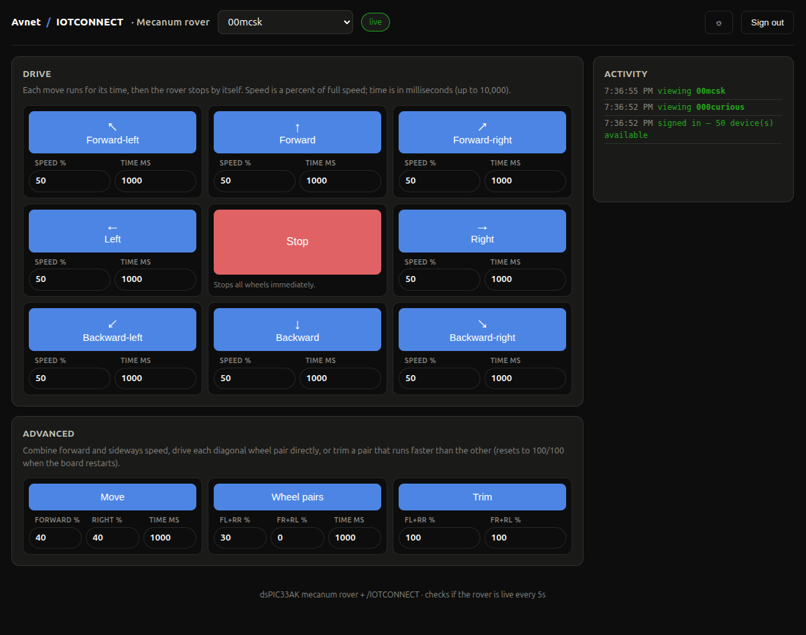

# Mecanum Rover Dashboard



A web dashboard for driving the rover. It has one button per move, with that move's parameters
in labeled fields underneath it, and an activity log of the commands this browser has sent.
A "live" indicator next to the device picker shows whether the rover is connected.
The rover's telemetry isn't shown here. See it on the device's **Live Data** tab in the
/IOTCONNECT console.

It has the same architecture as the
[iotc-mchp-dspic33ck-lvmcb](https://github.com/avnet-iotconnect/iotc-mchp-dspic33ck-lvmcb)
dashboard. One AWS Lambda serves the page and passes its /IOTCONNECT REST calls through.
Each person signs in with their own solution key, environment, email and password,
and the browser sends the solution key and environment with every request.

```
 browser (dashboard.html)
   |  fetch("api/dash/...") with the user's solution key/env/pf (headers) and bearer token
   v
 Lambda (lambda_function.py)
   v
 /IOTCONNECT REST API (login, device lookup, telemetry history, template-command)
```

## Panel Functions

| Panel | Source |
|---|---|
| Drive | `POST template-command/device/{guid}/send` with `forward`/`backward`/`left`/`right`/`stop`, and `move` for the four diagonals |
| Advanced | The same endpoint, sending `move`, `pairs` and `trim` with every parameter exposed |
| Activity | Every command this browser sent, plus sign-in notices and errors |
| "live" indicator | Age of the rover's newest telemetry message, checked every 5 seconds (see below) |

Each move's parameters are checked against the firmware's limits before the command is sent,
because the firmware's rejection only comes back in a command acknowledgement, which this page doesn't read.

The diagonal buttons send `move` with equal forward and sideways parts,
each half of the chosen speed, so the diagonal wheel pair that turns runs at that speed
(e.g. Forward-right at 50% sends `move 25 25 <ms>`).

## Live Indicator

The rover publishes telemetry every 10 seconds, so the page shows "live" while the newest message is
under 30 seconds old, and "offline" (with how long ago it last reported) otherwise.
The Lambda's `/telemetry` route finds that message with
`GET Telemetry/attribute-history/device/{duid}/from/{from}/to/{to}`, which returns each raw device
message, rather than `GET Telemetry/device/{guid}`. The lvmcb dashboard found that the latest-value
endpoint can return stale data with recent timestamps. The latest-value endpoint is only used
when the 10-minute history window has no telemetry message.

## Deployment

You'll need an AWS account and credentials. From this folder, run:

```
./deploy.sh
```

Then open the URL it prints and sign in (see "Sign-In" below).
Re-run `./deploy.sh` to update the deployment after a code change.

To do the same steps by hand:

1. **IAM role.** Create an execution role for the Lambda with the standard
   `AWSLambdaBasicExecutionRole` managed policy.
   `aws-deploy-policy.json` is the deploying user's policy, not this role.
2. **Zip & create the Lambda.**
   `zip -j lambda.zip lambda_function.py iotc_client.py dashboard.html`
   (all three files at the zip root), then create a Python 3.12 function from it.
   You can optionally set the `TEMPLATE_GUID` env var to this project's `dspic33car` device-template GUID
   (Settings &rarr; Device &rarr; Templates in the /IOTCONNECT console)
   to only list rover devices in the device picker.
3. **HTTP API.** Create an API Gateway HTTP API with a Lambda integration and a
   `$default` route (quick-create does this), then open the API's invoke URL.

To update the code by hand, re-zip the same three files and run
`aws lambda update-function-code --function-name <name> --zip-file fileb://lambda.zip`.

### Sign-In

Sign in with your /IOTCONNECT solution key, environment, email and password.
`env` is the same value `tools/provision_device_config.py --env` uses
(Settings &rarr; Key Vault in the console).
The solution key is a separate value, labeled "Solution Key" in the console.
The platform is fixed to `aws` in `dashboard.html`'s `PLATFORM` constant.
Check "Remember the solution key/environment on this device" to fill in those two fields next time.

## Files

| File | What it is |
|---|---|
| `lambda_function.py` | The backend, which serves `dashboard.html` at `/`, plus `/api/dash/login`, `/bootstrap`, `/telemetry` and `/command` |
| `iotc_client.py` | /IOTCONNECT REST client, a copy of the lvmcb dashboard's (itself from the `iotc-python-lite-sdk-demos` cockpit) |
| `dashboard.html` | The page, with login, live indicator, drive pad, advanced controls and activity log |
| `aws-deploy-policy.json` | IAM policy for the deploying user (not the Lambda's execution role) |
| `deploy.sh` | Creates or updates the IAM role, Lambda and HTTP API |

## Design Notes

- The solution key is kept in `sessionStorage` while someone is signed in,
  and in `localStorage` if they checked "remember". The password isn't stored.
- `boot()` guards against running twice. An auto-resumed session and a manual
  sign-in can both reach it while the `/bootstrap` call is in flight, and the second one
  would switch the device picker back to the first device (found on the lvmcb dashboard).
- Dark is the default theme, with light as a remembered toggle (top right),
  using the same CSS palette as the lvmcb dashboard.
